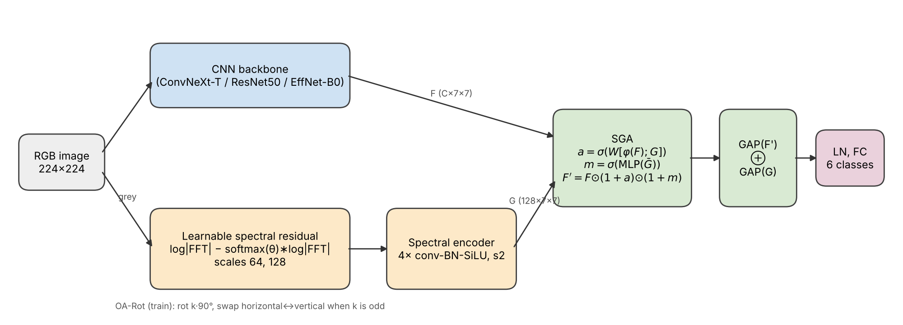

# SpecTexNet: Fabric Defect Classification

[](.github/workflows/tests.yml)
[](https://huggingface.co/spaces/codewithyeasin/fabric-defect-detection)

This repository holds the code, evaluation protocol and paper draft for classifying woven-fabric
images into six classes: defect-free, hole, horizontal, lines, stain and vertical.

Version 2 replaces the original notebook pipeline (frozen ResNet50 features with gradient boosting
written from scratch) with three things:

1. **SpecTexNet.** A CNN backbone plus a learnable multi-scale *spectral residual* branch. Fabric is
   close to periodic, so removing the smooth part of its log Fourier spectrum leaves the places
   where the weave breaks. A spectral-guided attention (SGA) module uses those maps to gate the
   backbone features.
2. **Orientation-aware augmentation (OA-Rot / OA-TTA).** Rotating a *horizontal* defect by 90°
   turns it into a *vertical* defect. OA-Rot rotates and swaps the two labels, and OA-TTA applies
   the same swap to predicted probabilities.
3. **A leakage-free protocol.** Perceptual-hash de-duplication, stratified group 5-fold CV,
   macro-F1 / balanced accuracy / MCC, bootstrap confidence intervals, McNemar and
   Friedman/Nemenyi tests. The v1 method is re-run on the same folds as a baseline.

`docs/AUDIT_v1.md` lists the problems found in v1 and how each one is handled. The most important
one is in the data itself: three quarters of the defect images are binarised copies of other
images, and defect-free and defective images come from different cameras. `prepare_data.py` and
`shortcut_check.py` handle and measure both.

<p align="center"></p>

## Results

The table in `paper/tables/table_main.tex` is generated by `scripts/aggregate.py` from the
finished runs. No number in this README or in the paper is typed by hand. After running the
pipeline, paste the headline row here:

| Model | Macro-F1 | Balanced acc. | Acc. |
|-------|----------|---------------|------|
| Frozen ResNet50 + GBDT ensemble (v1, re-evaluated) | run pipeline | | |
| SpecTexNet (ConvNeXt-T) | run pipeline | | |

## Repository layout

```
configs/            default.yaml (shared recipe) and experiments.yaml (all models and ablations)
src/fabricnet/      library: data (index, dedup, folds, OA-Rot), models (SpecTexNet, baselines),
                    engine, losses, metrics, stats, explain, efficiency, legacy (v1 GBDT)
scripts/            command-line entry points (see below)
notebooks/          run_experiments_colab.ipynb, which runs everything on a Colab GPU
paper/              LaTeX manuscript; tables/ and figures/ are filled in by the scripts
deploy/hf_space/    Gradio app for Hugging Face Spaces (safetensors, no pickle)
legacy/             v1 notebooks, deployment code and metrics, kept for reference
tests/              CPU unit tests plus a synthetic end-to-end smoke test (GitHub Actions)
```

## Quick start

```bash
pip install -r requirements.txt
pytest -q                                   # about 20 s on CPU

# 1. data: Kaggle "nexuswho/fabric-defects-dataset" unzipped into data/raw/
python scripts/prepare_data.py --roots "data/raw/Fabric Defects Dataset" --out data

# 2. one model, all five folds
python scripts/train.py --exp spectex_convnext_tiny

# 3. everything (v1 baseline, 9 models, 7 ablations, figures, statistics, tables, deployment export)
bash scripts/run_all.sh "data/raw/Fabric Defects Dataset"
```

On Kaggle (recommended, free 2x T4), import `notebooks/run_experiments_kaggle.ipynb`. It runs the
work in three committed batches, uses both GPUs in parallel and resumes from the previous batch's
output. On Colab, open `notebooks/run_experiments_colab.ipynb`. It copies results to Google Drive after
each experiment and skips finished folds, so it survives disconnects.

| Script | What it does |
|--------|--------------|
| `prepare_data.py` | index images, de-duplicate, write `data/splits.csv` and `data/dedup_report.json` |
| `train.py --exp NAME` | train and test one experiment on every fold (`--full` trains on all data for deployment) |
| `run_legacy_v1.py` | v1 frozen-ResNet50 + scratch GBDT, linear probe, on the same folds (`--prefix leaky_` for the leakage study) |
| `shortcut_check.py` | how well metadata alone predicts the class (source-shortcut audit) |
| `run_queue.py` | run several experiments in parallel, one per GPU, with a time budget |
| `aggregate.py` | summary JSON, significance tests, LaTeX tables, confusion/CD/reliability figures |
| `benchmark_efficiency.py` | parameters, GMACs, CPU/GPU latency |
| `explain.py` | Grad-CAM, spectral saliency and SGA gate figure |
| `figure_method.py`, `figure_architecture.py` | method figures for the paper |
| `cross_dataset.py` | zero-shot test on an external dataset (for example TILDA, AITEX) |
| `export_model.py` | write `model.safetensors` and config into `deploy/hf_space/` |

Experiment names are defined in `configs/experiments.yaml`. Any config value can be changed from
the command line, for example `--set train.epochs=60 data.img_size=256`.

## Deployment

```bash
python scripts/train.py --exp spectex_convnext_tiny --full
python scripts/export_model.py --run results/spectex_convnext_tiny/full
cd deploy/hf_space   # push this folder to the Space repo (git-lfs for *.safetensors)
```

The Space shows class probabilities, a defect / no-defect decision with an adjustable threshold,
Grad-CAM, and the spectral saliency map.

## Reproducibility notes

- Seeds are fixed per fold (`seed + 100*repeat + fold`). cuDNN autotuning is on, so GPU runs can
  differ in the last digit.
- `data/splits.csv` is committed after you create it. Anyone can then reuse the exact folds.
- The synthetic data generator (`scripts/make_synthetic_data.py`) exists only for tests. Do not
  report numbers from it.

## Citation

See `CITATION.cff`. The dataset is "Fabric Defects Dataset" by nexuswho on Kaggle (CC BY 4.0).
